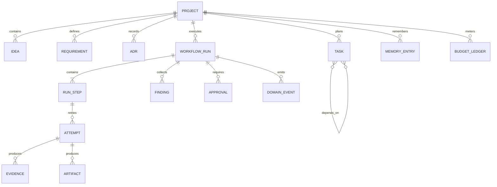

# Data Model and Persistence

## Persistence decision

SQLite remains the authoritative MVP database because the local product has one scheduler writer,
modest concurrency, existing rusqlite/WAL code, simple backup, and no cross-host transaction
requirement. Each project retains its AGTX database; the global index stores project discovery and
cross-project summaries. Large logs/artifacts live in a content-addressed directory with metadata in
SQLite. PostgreSQL is deferred until multi-user concurrency, hosted availability, or operational
evidence warrants ADR-009 supersession.

## Domain relationships

## Aggregate tables

All IDs are UUID strings initially; timestamps are UTC RFC3339 plus monotonic duration fields where
needed. Mutable aggregate rows carry `version INTEGER` for optimistic concurrency.

| Table | Key fields and constraints |
|---|---|
| `schema_migrations` | `version PK`, `name`, `checksum`, `applied_at`; checksum mismatch fails startup |
| `ideas` | `id PK`, `project_id`, `title`, `problem`, `status`, `current_artifact_id`, timestamps/version |
| `requirements` | `id PK` (stable human ID), `project_id`, `artifact_version`, `kind`, text, priority, status, source |
| `adrs` | `id PK`, `number UNIQUE/project`, `status`, `supersedes_id`, `artifact_digest`, accepted actor/time |
| `tasks` | Existing AGTX fields plus `requirement_refs`, `risk`, `estimate_class`, `workflow_id`, version |
| `task_dependencies` | `(task_id, dependency_id) PK`, `kind=hard/soft/artifact`, no self-edge; DAG validation |
| `workflow_definitions` | `id`, semantic `version`, schema version, digest, source, enabled, policy digest |
| `workflow_runs` | `id`, project/task/workflow refs, state, current revision/SHA, priority, policy/budget refs, version |
| `run_steps` | `id`, run, stable key, role/kind, state, ordinal, dependency expression, input digest, version |
| `attempts` | `id`, step, number, state, idempotency key UNIQUE, lease owner/expiry, retry_at, result/error class |
| `events` | append-only `sequence PK`, event ID UNIQUE, aggregate/type/version, actor, correlation, payload JSON |
| `outbox` | event ID UNIQUE, destination, payload, attempts, available_at, delivered_at; written with state |
| `artifacts` | digest PK, media type, size, storage URI, producer, redaction state, created/retention timestamps |
| `artifact_links` | artifact digest to requirement/task/run/attempt relation and role |
| `evidence` | `id`, attempt, gate key, commit SHA, command/tool/environment digests, status, timestamps, log digest |
| `findings` | `id`, run, fingerprint, priority, category, location JSON, evidence, status, first/last attempt |
| `finding_actions` | finding, action, actor, reason, repair attempt, timestamp; append-only history |
| `approvals` | `id`, kind, subject, actor, decision, head SHA, evidence/policy digest, expires/revoked timestamps |
| `memory_entries` | `id`, project, kind, body, source type/id/digest, confidence, status, supersedes, visibility, timestamps |
| `budgets` | project/run scope, concurrency/time/attempt/cost/disk/token limits, window and policy version |
| `usage_ledger` | append-only reservation/estimate/actual/release records by provider/resource/currency/unit |
| `provider_accounts` | provider, opaque account/profile reference, capability/auth/quota status; no raw secret |
| `audit_log` | append-only actor/action/target/decision/reason/correlation/request digest/time |

Existing `transition_requests`, `notifications`, `task_runtime`, projects, running agents, heartbeat,
board watch, and mobile device tables remain during migration. Application repositories provide one
model while compatibility adapters incrementally move TUI behavior.

## State and evidence constraints

- A run step cannot be `succeeded` without a succeeded current attempt.
- A gate cannot be `passed` without evidence whose commit SHA equals the run candidate SHA and whose
  command/environment digests equal the current gate definition.
- One non-expired active lease exists per attempt; lease owner renewal uses compare-and-swap version.
- Approval validity is computed, never copied: decision is approve, subject/head/evidence/policy match,
  actor authorized, not expired/revoked, and no invalidating event follows it.
- Artifact files are written to a temporary path, hashed, atomically moved, then metadata committed.
  Missing files are corruption, not empty content.
- Events and outbox entries are inserted in the same transaction as aggregate changes.

## Migration policy

Replace ignored additive `ALTER TABLE` errors for new Engineering OS tables with numbered,
transactional migrations and checksums. Existing upstream compatibility migrations remain until a
documented baseline compaction. Migration startup makes a backup checkpoint, refuses unknown newer
schemas, and never downgrades automatically. Each migration has upgrade, compatibility, fixture, and
backup/restore tests.

## Backup, retention, and privacy

Use SQLite online backup/checkpoint plus artifact manifest. A successful backup stores DB digest,
artifact digests, schema version, app version, project ID, and timestamp. Restore targets a new
profile first and verifies referential/artifact integrity before activation. Logs and bulky artifacts
have configurable retention; audit, decisions, approvals, and release evidence use longer policy.
Secret detection/redaction occurs before persistence, and deletion honors local retention policy.

## Future tenancy

Domain IDs and repository methods accept a scope object, but local schema does not pretend to offer
tenant isolation. A future managed repository adds organization/project partition keys and database
row/object controls under a dedicated ADR and migration plan. Local SQLite files never become a
shared multi-tenant database.
