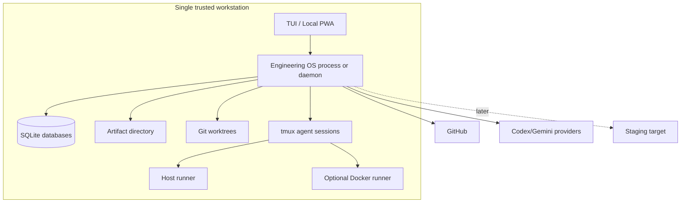
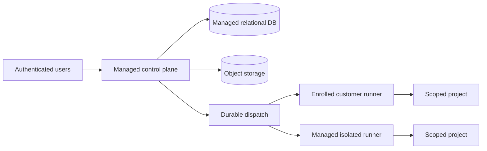

# Deployment Architecture

## Local MVP profiles



`engineering-os` starts the interactive board; `engineering-os daemon <project|--all>` runs the
scheduler without a TUI. A per-project database lease prevents two active schedulers. The web server
binds loopback by default and keeps AGTX's deliberate exposure controls. Launchd/systemd examples
must use a dedicated profile directory, restart-on-failure, file permissions, and resource limits.

## Filesystem layout

```text
~/.config/engineering-os/       global config, provider profile references, logs policy
~/.local/share/engineering-os/  global index, local artifacts, backups
<project>/.agtx/                compatible project database and worktrees (existing default)
<project>/.engineering-os/      versioned workflow policy and optional project artifacts
```

Migration from AGTX paths must be backward compatible and must not move data silently. Secrets stay
in OS/provider stores or explicit external secret providers, not these files.

## Isolation profiles

| Profile | Use | Guarantees | Limitations |
|---|---|---|---|
| `host-restricted` | Default when containers unavailable | Canonical worktree, structured commands, env/secret allow-list, time/output/process limits | Same host kernel/user; network and filesystem isolation are policy-level |
| `docker-isolated` | Validation and higher-risk implementation | Mounted worktree only, read-only base, explicit network, CPU/memory/PID/disk limits, disposable container | Docker daemon privilege; macOS VM overhead; image supply chain |
| `external-runner` | Future OpenHands/remote backend | Same signed/scoped request contract and returned evidence | Requires enrollment, transport identity, tenant controls; not MVP |

## Low-spec resource policy

Reference minimum is 4 cores, 8 GiB RAM, and 15 GiB free disk. Default concurrency is one agent and
one validation job, reduced to one total process when free memory is below 2 GiB. Scheduler reserves
250 MiB; Docker jobs use explicit 2 GiB default memory and 2 CPU limit. Disk preflight includes
worktree estimate, build allowance, artifact retention, and a 3 GiB safety reserve. Logs stream to
bounded files; UI queries paginate. Build caches are project-scoped and operator-cleanable.

## Staging and release path

Staging is an adapter invoked only after a PR/current revision has valid required evidence and any
configured approval. The adapter returns immutable revision and environment evidence. Health checks
run through deterministic gates. Failure invokes configured rollback or stops for the operator.
Engineering OS records release approval but does not autonomously merge or deploy production in MVP.

## Backup and disaster recovery

Scheduled local backup uses SQLite online backup plus artifact manifest to an operator-selected
directory. Target objectives: RPO 24 hours by default and RTO 30 minutes for a single project;
operators can tighten schedules. Restore always verifies in a new profile, then switches explicitly.
Corrupt DB, missing artifact, and incompatible schema drills are release tests.

## Future commercial topology



This is a future option, not an MVP prescription. PostgreSQL/object storage/queue technology is
selected only with tenant count, concurrency, availability, region, backup, and operating-cost data.
Remote runners require mutually authenticated enrollment, short-lived jobs/secrets, egress policy,
artifact integrity, revocation, and tenant-isolation tests. Local mode remains a complete product.

## Deployment risks

- Docker can exhaust disk or fail to start; preflight, cache budgets, and host fallback are required.
- tmux persistence does not equal crash-safe workflow state; scheduler reconciliation is mandatory.
- Public web exposure turns agent control into remote-code-execution authority; multi-user public
  exposure is prohibited until authenticated service architecture ships.
- Staging adapters have provider-specific rollback semantics; “rollback requested” must not be
  reported as “rollback succeeded” without observed health evidence.
