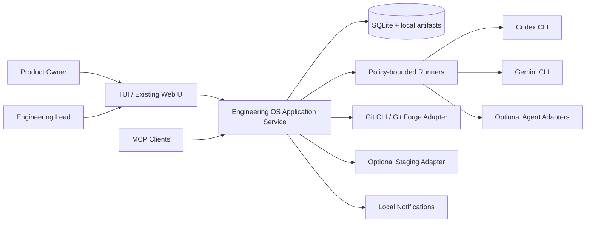
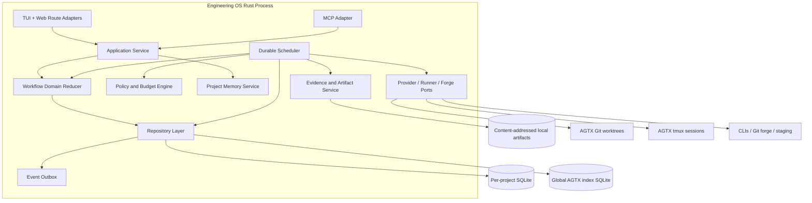
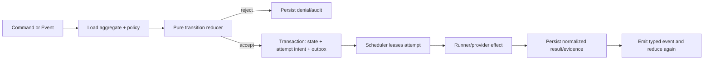

# System Architecture

## Architectural style

Engineering OS is a local-first Rust modular monolith built by extending AGTX. Domain decisions are
pure and testable; SQLite persists authoritative local state; a durable scheduler coordinates
effects; runner and provider ports isolate external execution; TUI, MCP, and web are clients of the
same application service. This preserves the working AGTX foundation while removing the current
dependency on a live TUI for orchestration.

No PostgreSQL, distributed workflow engine, separate Node backend, or new frontend is justified for
MVP. Those choices require load, tenancy, availability, or deployment requirements that SQLite and
the existing Rust/web stack cannot meet, plus a dedicated ADR.

## System context

The trusted computing base is the Engineering OS binary, approved configuration/policy, SQLite,
the local OS, Git, and selected isolation backend. Repositories, agent output, dependencies,
plugins, tool output, and remote responses are untrusted inputs.

## Logical containers

## Core invariants

1. SQLite state is authoritative for workflow status; terminal panes and agent prose are evidence,
   never authoritative state.
2. A pure reducer validates every transition against current state, event, dependencies, policy,
   budgets, and evidence.
3. Side effects occur only through persisted attempts with a lease and idempotency key.
4. Agent roles cannot write gate results, policy, approval, quota, or identity records.
5. Every artifact/evidence record is content-digested and bound to its producing attempt and commit.
6. TUI, web, and MCP use the application service; none directly implement alternate transition
   logic.

## Workflow control

Commands express operator intent; events state observed facts. The reducer never invokes external
systems. A scheduler may run in the foreground with the TUI or as `engineering-os daemon`; a
single-writer lease prevents simultaneous schedulers for a project.

## Agent permission boundaries

| Role | Reads | Writes | Explicitly prohibited |
|---|---|---|---|
| Planner/Supervisor (Codex default) | Approved project context, requirements, decisions, task/evidence summaries | Planning artifacts, task proposals, escalation notes | Source edits unless assigned implementation; gate pass; policy/budget changes; release approval |
| Developer/Repairer (Gemini default) | Assigned worktree, accepted plan, selected findings, declared tools | Assigned worktree and handoff artifact | Other worktrees/project roots; secrets not declared; task approval; PR merge/deploy |
| Reviewer (Codex default) | Diff, source, requirements, test evidence | Structured findings and recommendation | Source edits in review attempt; finding auto-acceptance; gate pass; release approval |
| Deterministic runner | Declared workspace/inputs/toolchain | Evidence/log artifacts and normalized result | Interpreting product intent; widening its own policy |
| Forge/deploy adapter | Minimum scoped credentials and declared request | Idempotent external effect plus normalized state | Credential export; undeclared repo/environment; approval fabrication |

## Availability and recovery

Local MVP targets recoverability rather than high availability. SQLite WAL, short transactions,
leases, event/outbox records, process supervision, and external reconciliation support restart. A
running agent process may not survive a host restart; the attempt becomes `unknown`, its worktree
and provider session are inspected, and policy chooses resume, retry, or intervention. Corrupt or
unreadable databases fail closed and direct the operator to verified backup restore.

## Evolution to multi-user operation

Repository traits, tenant-ready identifiers, actor/correlation fields, scoped runner requests, and
versioned contracts are established early. They do not add a tenant column to every local query or
introduce network services prematurely. A future control plane may implement the same ports with an
authenticated API, PostgreSQL, object storage, and remote runners only after ADR and isolation/load
evidence. Local mode remains supported and does not depend on that service.
