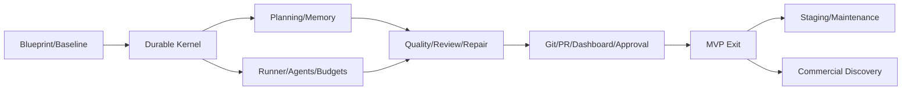

# Dependency-Aware Implementation Backlog

## Conventions

`Depends` lists hard dependencies by task ID. A task is complete only when its required evidence and
linked acceptance criteria pass. Estimate classes are XS (≤1 day), S (2–3 days), M (≤1 week), L
(1–2 weeks), and XL (must be split before implementation). P0 blocks all product workflows; P1
blocks MVP; P2 is a planned increment. Agent roles are defaults and remain adapter-configurable.

## M0 — Blueprint and baseline

| ID | Work | Depends | Pri/Size | Default role | Evidence / acceptance |
|---|---|---|---|---|---|
| EOS-0001 | Import and audit AGTX, licenses, environment, and baseline tests | — | P0/M | Codex | Existing audit/report |
| EOS-0002 | Product/architecture/security blueprint with traceable IDs | EOS-0001 | P0/L | Codex | Required docs; `git diff --check`; AC coverage review |
| EOS-0003 | Recover Rust/Docker validation environment and run complete upstream suite | EOS-0001 | P0/S | Human/operator | Exact successful commands in implementation report |
| EOS-0004 | Add requirements/backlog consistency checker | EOS-0002, EOS-0102 | P1/S | Gemini | Fails on missing/duplicate IDs and broken acceptance links |

## M1 — Durable workflow kernel

| ID | Work | Depends | Pri/Size | Default role | Evidence / acceptance |
|---|---|---|---|---|---|
| EOS-0101 | Define Rust domain types for runs, steps, attempts, commands, events, errors | EOS-0002 | P0/M | Gemini | Reducer unit fixtures compile; no I/O imports in domain module |
| EOS-0102 | Add numbered/checksummed migration framework compatible with current AGTX DB | EOS-0003 | P0/M | Gemini | Upgrade/unknown-newer/checksum/rollback fixture tests |
| EOS-0103 | Add run/step/attempt/event/outbox/lease/idempotency repositories | EOS-0101, EOS-0102 | P0/L | Gemini | Transaction/invariant/concurrency tests; DATA_MODEL mapping |
| EOS-0104 | Implement pure transition reducer and dependency eligibility | EOS-0101 | P0/L | Gemini | State-table tests; AC-P2-001 |
| EOS-0105 | Implement scheduler claim/renew/complete with single-writer project lease | EOS-0103, EOS-0104 | P0/L | Gemini | Competing-worker tests; stale lease tests |
| EOS-0106 | Implement startup recovery and effect reconciliation framework | EOS-0105 | P0/L | Gemini | Crash injection matrix; AC-P2-002 |
| EOS-0107 | Extract application service used by TUI, MCP, and web | EOS-0104, EOS-0105 | P1/L | Gemini | Contract tests prove identical transition decisions |
| EOS-0108 | Encode default Codex→Gemini→gates→review→repair→PR workflow definition | EOS-0104 | P1/M | Codex/Gemini | Parser/reducer fixture; FR workflow trace |

## M2 — Planning, blueprint, and memory

| ID | Work | Depends | Pri/Size | Default role | Evidence / acceptance |
|---|---|---|---|---|---|
| EOS-0201 | Versioned artifact metadata and content-addressed local store | EOS-0102 | P1/M | Gemini | Atomic-write/corruption/retention tests |
| EOS-0202 | Idea discovery and versioned PRD generator workflow | EOS-0107, EOS-0201 | P1/M | Codex | Golden artifact fixture; AC-P1-001 |
| EOS-0203 | Blueprint/backlog generator with requirement/acceptance links | EOS-0202 | P1/L | Codex | Traceability checker; AC-P1-001 |
| EOS-0204 | ADR create/accept/supersede and impact-query service | EOS-0107, EOS-0201 | P1/M | Gemini | Immutable history tests; AC-P1-002 |
| EOS-0205 | Project memory entries, sources, verification, supersession, FTS retrieval | EOS-0102, EOS-0201 | P1/L | Gemini | Provenance/retrieval/restore tests; AC-P5-003 |
| EOS-0206 | Planning approval UI in TUI and existing web app | EOS-0202, EOS-0203, EOS-0107 | P1/M | Gemini | UI/API tests; blocked tasks remain ineligible |

## M3 — Policy-bounded runner, agents, and budgets

| ID | Work | Depends | Pri/Size | Default role | Evidence / acceptance |
|---|---|---|---|---|---|
| EOS-0301 | Structured permission, command, environment, network, secret, and limit model | EOS-0101 | P0/M | Gemini | Policy property tests and denial audit |
| EOS-0302 | Host-restricted runner with canonical path and process-tree cancellation | EOS-0301, EOS-0201 | P0/L | Gemini | Traversal/symlink/timeout/output abuse tests; AC-P2-003 |
| EOS-0303 | Docker runner with pinned image, mounts, network, CPU/memory/PID limits | EOS-0301, EOS-0201, EOS-0003 | P1/L | Gemini | Container escape-surface configuration tests; parity fixtures |
| EOS-0304 | Agent adapter trait and capability/auth/quota diagnostics | EOS-0101, EOS-0301 | P0/M | Gemini | Adapter contract suite; token-redaction tests |
| EOS-0305 | Codex planner/supervisor/reviewer adapter | EOS-0304 | P1/M | Gemini | Mocked and opt-in live smoke tests |
| EOS-0306 | Gemini implementation/repair adapter | EOS-0304 | P1/M | Gemini | Mocked and opt-in live smoke tests |
| EOS-0307 | Budget reservations and usage ledger for concurrency/time/attempt/disk/cost | EOS-0103, EOS-0105 | P1/L | Gemini | Exhaustion/release/restart tests; AC-P5-002 |
| EOS-0308 | Plugin v2 validation and legacy AGTX compatibility mapper | EOS-0301, EOS-0108 | P1/L | Gemini | Permission/compatibility fixtures; AC-P2-003 |

## M4 — Objective quality, review, and bounded repair

| ID | Work | Depends | Pri/Size | Default role | Evidence / acceptance |
|---|---|---|---|---|---|
| EOS-0401 | Gate definition resolver, dependency order, and invalidation rules | EOS-0104, EOS-0301 | P0/M | Gemini | Gate DAG/current-SHA unit tests |
| EOS-0402 | Runner evidence capture with command/tool/environment/commit digests | EOS-0201, EOS-0302, EOS-0401 | P0/M | Gemini | Tamper/staleness tests; AC-P3-002 |
| EOS-0403 | Structured finding inventory, fingerprinting, deduplication, dispositions | EOS-0103, EOS-0201 | P1/L | Gemini | Golden/fuzz fixtures; stable ID test |
| EOS-0404 | Codex review step over diff, requirements, and evidence | EOS-0305, EOS-0402, EOS-0403 | P1/M | Codex/Gemini | Structured output contract; AC-P3-001/003 |
| EOS-0405 | Gemini selected-finding repair step in separate attempt/worktree | EOS-0306, EOS-0403 | P1/M | Gemini | Scope/selection tests |
| EOS-0406 | Bounded review/repair controller and retest invalidation | EOS-0401, EOS-0404, EOS-0405, EOS-0307 | P1/L | Gemini | Cycle/budget/escalation tests; AC-P3-001/003 |

## M5 — Git, PR, dashboard, and release control

| ID | Work | Depends | Pri/Size | Default role | Evidence / acceptance |
|---|---|---|---|---|---|
| EOS-0501 | Harden worktree path/cleanup and candidate SHA reconciliation | EOS-0301, EOS-0106 | P0/M | Gemini | Main-worktree/dirty/path safety tests |
| EOS-0502 | Forge trait and GitHub `gh` adapter with PR idempotency/check normalization | EOS-0501, EOS-0402 | P1/L | Gemini | Fake-forge retry tests; AC-P4-001 |
| EOS-0503 | PR description evidence/requirements/findings/risk renderer | EOS-0502, EOS-0406 | P1/S | Codex/Gemini | Golden PR fixture |
| EOS-0504 | Head/evidence/policy-bound approval service and invalidation | EOS-0103, EOS-0402, EOS-0502 | P0/M | Gemini | Authorization/invalidation tests; AC-P4-002 |
| EOS-0505 | Multi-project actionable dashboard queries and TUI views | EOS-0107, EOS-0307, EOS-0403 | P1/L | Gemini | Snapshot/query tests; AC-P5-001 |
| EOS-0506 | Extend current PWA with run timeline, evidence, findings, budgets, approvals | EOS-0107, EOS-0504, EOS-0505 | P1/L | Gemini | Axum/client tests; AC-P5-001 |
| EOS-0507 | Backup/restore command and manifest verification | EOS-0102, EOS-0201, EOS-0205 | P1/M | Gemini | Clean-profile restore drill; AC-P5-003 |

## M6 — Staging and maintenance increment

| ID | Work | Depends | Pri/Size | Default role | Evidence / acceptance |
|---|---|---|---|---|---|
| EOS-0601 | Deployment adapter trait and no-op/fake provider | EOS-0301, EOS-0402 | P2/M | Gemini | Contract/retry/idempotency tests |
| EOS-0602 | One staging provider adapter selected by product demand | EOS-0601, EOS-0504 | P2/L | Gemini | Staging/health/rollback fixture; AC-P4-003 |
| EOS-0603 | Opt-in scheduled maintenance task proposals | EOS-0106, EOS-0307, EOS-0505 | P2/M | Gemini | Quiet-unchanged/actionable-change tests |
| EOS-0604 | Operational health, retention, diagnostics, backup status dashboard | EOS-0505, EOS-0507 | P2/M | Gemini | Failure-injection UI tests |

## M7 — Commercial readiness discovery

No implementation begins until local MVP evidence exists. Discovery tasks measure real concurrent
writers, project/tenant scale, runner trust, availability, retention, regional, support, and cost
requirements; produce ADRs for identity/RBAC, API topology, storage, dispatch, object storage,
metering, and migration. PostgreSQL or a workflow engine is not a predetermined outcome.

## Milestone dependency graph

