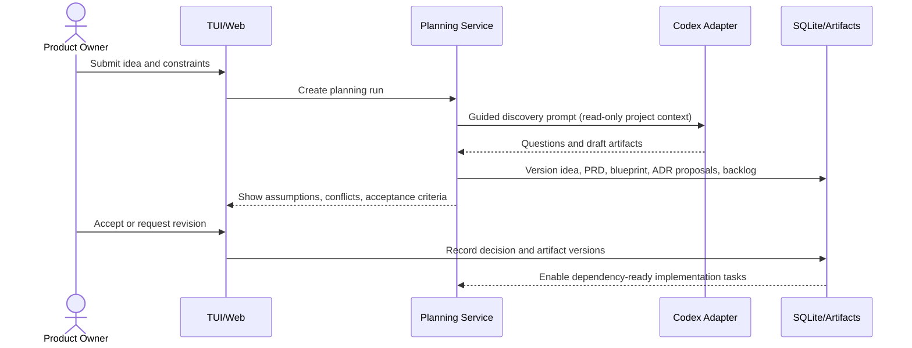
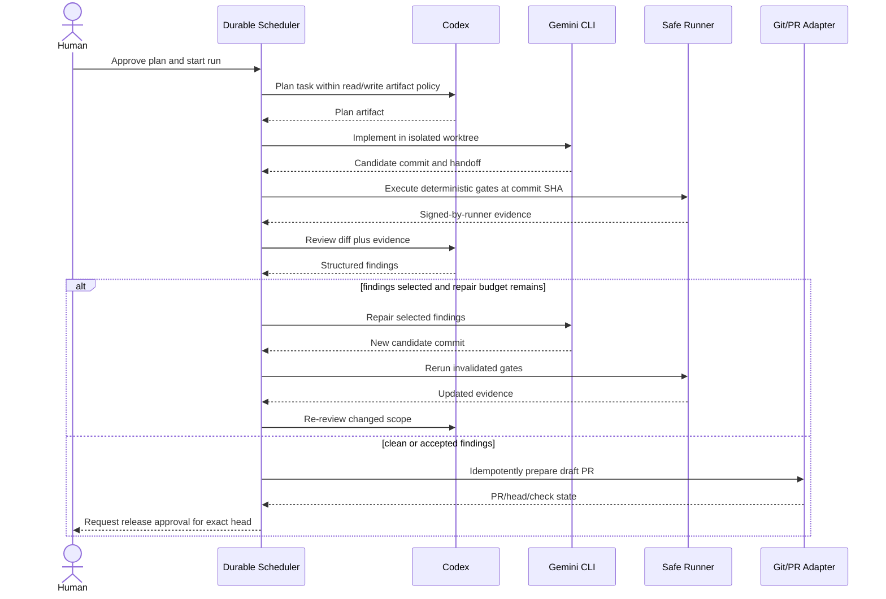
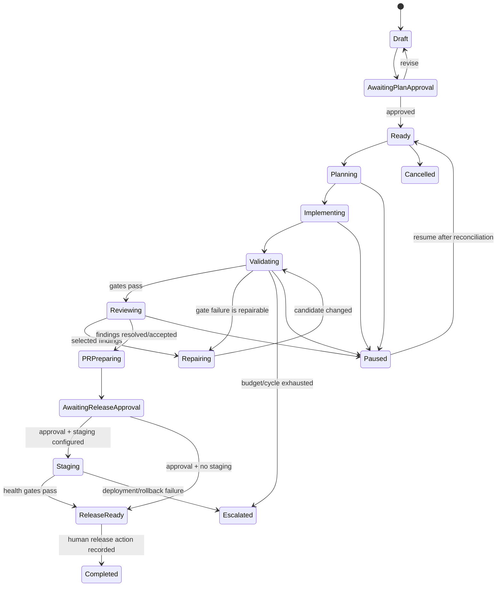

# User Flows

## Idea to approved engineering plan

Planning never grants write execution beyond its artifact workspace. Acceptance records the exact
artifact versions; later edits create a new revision and impact analysis.

## Default idea-to-PR workflow

## Run-state model

An attempt may independently be `queued`, `leased`, `running`, `succeeded`, `failed`, `timed_out`,
`cancelled`, `unknown`, or `reconciling`. Run state advances only from persisted events and policy.

## Crash recovery

1. Acquire a time-bounded lease and persist the intended effect plus idempotency key.
2. Execute the effect and persist result/evidence transactionally with an outbox event.
3. On restart, mark expired running attempts `unknown`, inspect local process/worktree and provider
   state, then classify them as completed, safe-to-retry, failed, or operator-required.
4. Never retry PR creation, deployment, comments, or release actions before external reconciliation.
5. Present recovery decisions and evidence in the activity timeline.

## Human release approval

The UI shows PR, head SHA, gates, accepted/unresolved findings, staging health, cost, and risk. An
authorized human approves or rejects. Approval stores that evidence-set digest. Any head, gate,
finding disposition, environment, or policy change invalidates the approval and returns the run to
the appropriate state.

## Maintenance flow

An opt-in schedule emits a normal task proposal. Policy checks quota and maintenance window, then
runs read-only discovery. Changes require the same implementation, validation, review, PR, and human
release path as interactive work. Unchanged checks remain quiet; failures and actionable updates are
visible on the dashboard.
